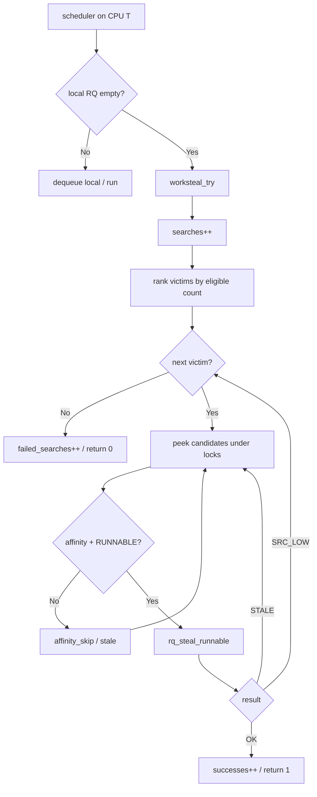
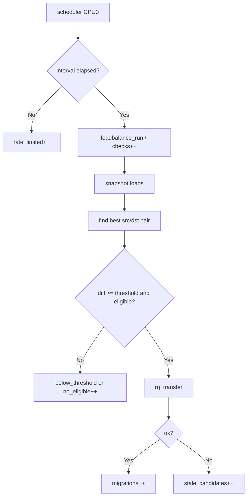
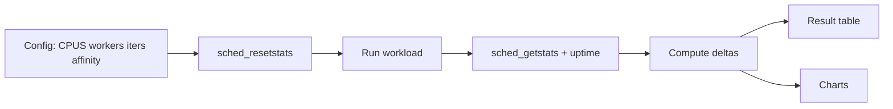

# Figma / Diagram specs – Module 3

Dùng nội dung này để vẽ trên Figma (frames + arrows + color legend).  
Có kèm Mermaid để nhúng markdown / Notion.

## Legend (màu thống nhất)

| Color | Meaning |
|-------|---------|
| Blue | Scheduler / control flow |
| Green | Successful migration |
| Orange | Decision / threshold check |
| Red | Reject (affinity / stale / empty) |
| Gray | Stats update |
| Purple | User workload / benchmark |

---

## Frame 1 – Work Stealing flow

**Title:** Work Stealing – idle CPU steals one runnable process

**Nodes (top → bottom):**

1. `scheduler()` on CPU T (thief)
2. Local `rq_length(T) == 0`?  
   - No → dequeue local / run  
   - Yes → `worksteal_try(T, online_mask)`
3. `ws_stats[T].searches++`
4. Build ranked victim list  
   - Skip offline, self, `load <= 1`  
   - Score = count eligible (affinity OK)
5. For each victim in rank order:
   - Peek candidates
   - `acquire(p->lock)`
   - Check RUNNABLE + `rq_cpu` + `cpu_allowed(p, T)`
   - `rq_steal_runnable(victim, T, p)`
6. Outcomes:
   - **OK** → `successes++`, enqueue on T, return 1 (green)
   - STALE / INELIGIBLE → `stale++`, next candidate (red)
   - SRC_LOW → next victim (orange)
   - No success after all → `failed_searches++` (gray)

**Mermaid:**



---

## Frame 2 – Load Balancing flow

**Title:** Load Balancing – periodic migration by CPU 0

**Nodes:**

1. `scheduler()` on CPU 0
2. `now_ticks - lb_last_tick >= LB_INTERVAL_TICKS`?  
   - No → `rate_limited++`, skip  
   - Yes → `loadbalance_run`
3. `checks++`
4. Snapshot `load[cpu] = rq_len + busy` for online CPUs
5. Scan pairs (src, dst): `diff = load[src]-load[dst]`
6. Keep best pair with `diff >= LB_IMBALANCE_THRESHOLD` and eligible process
7. `rq_transfer(src, dst, p, threshold)`
8. Success → `migrations++` (green)  
   Fail → `stale_candidates++` or `no_eligible_pair` / `below_threshold`

**Mermaid:**



---

## Frame 3 – Affinity guard (shared by WS & LB)

```
Candidate process P
  → cpu_allowed(P, dst)? 
      No  → affinity_skips++ / reject
      Yes → migrate allowed
```

Nhấn mạnh: **WS và LB không được phá CPU affinity (Module 2).**

---

## Frame 4 – Benchmark pipeline (Workload → Chart)

**Title:** From workload to evaluation chart

**Horizontal swimlanes:**

1. **Config** (purple): CPUS, workers, iters, affinity mode, run id  
2. **Control** (blue): `sched_resetstats` → start `uptime`  
3. **Workload** (purple): testws / ws_lb_test / benchmark  
4. **Collect** (blue): `sched_getstats` + end `uptime` + optional getcpu samples  
5. **Derive** (gray): delta WS/LB, elapsed, KOps/s  
6. **Report** (green): table row + bar charts  
   - Chart A: elapsed vs workers  
   - Chart B: ws_successes / lb_migrations vs scenario  
   - Chart C: throughput baseline vs SMP scheduler  

**Mermaid:**



---

## Frame 5 – Scheduler integration (context)

```
scheduler loop:
  online_mask = sched_online_mask()
  if cpu==0: loadbalance_run(...)
  p = dequeue local RQ
  if p==0: worksteal_try(...); dequeue again
  if p: check affinity → run or re-enqueue
  else: idle / wfi
```

---

## Figma layout suggestion

- Page **M3 Flows**: Frame1 WS | Frame2 LB | Frame3 Affinity  
- Page **M3 Benchmark**: Frame4 pipeline + example chart placeholders  
- Page **M3 Integration**: Frame5 + file map (worksteal / loadbalancing / runqueue / schedstats)

Export PNG vào `pic/` trong repo khi xong (ví dụ `pic/m3-ws-flow.png`, `pic/m3-lb-flow.png`, `pic/m3-bench-pipeline.png`).
